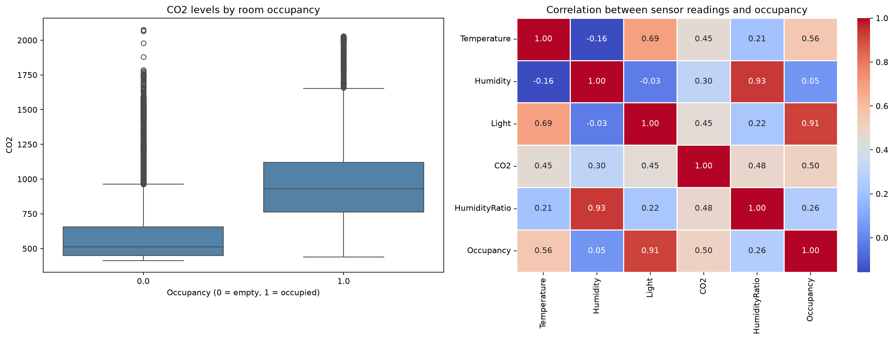

# Smart Office Occupancy Detection

Análisis de datos y aprendizaje automático para detectar si una oficina está ocupada a partir de mediciones ambientales. El proyecto estudia cómo las lecturas de temperatura, humedad, luz, CO₂ y razón de humedad se relacionan con la presencia de personas, y compara modelos de clasificación para identificar una alternativa de buen rendimiento.

## Contexto y objetivo

En edificios inteligentes, conocer la ocupación de una sala puede ayudar a gestionar iluminación y climatización de forma más eficiente. Este proyecto utiliza el conjunto público **Occupancy Detection** del UCI Machine Learning Repository para clasificar cada observación como ocupada (`1`) o vacía (`0`).

El análisis contempla un objetivo de referencia de **97 % de accuracy**. Los resultados obtenidos con la partición y la validación descritas aquí superan ese valor; no constituyen una garantía de rendimiento en edificios o ubicaciones no representados en el conjunto de datos.

## Resultados

La siguiente tabla resume la comparación de modelos por validación cruzada estratificada de cinco particiones aplicada al conjunto de entrenamiento. Las cifras se generan al ejecutar el notebook; pueden variar ligeramente según las versiones de las dependencias o una actualización del dataset.

| Modelo | Accuracy media (CV) | Desviación estándar |
| --- | ---: | ---: |
| Regresión logística | 98,90 % | 0,27 % |
| Árbol de decisión | 98,97 % | 0,28 % |
| K vecinos más cercanos (KNN) | **99,23 %** | 0,23 % |

KNN fue el mejor modelo de referencia. Al ajustar su número de vecinos con `GridSearchCV`, la configuración seleccionada fue `n_neighbors=3`, con **99,30 %** de accuracy media en validación cruzada y **99,27 %** en el conjunto de prueba reservado.

En el análisis exploratorio, **Light** presentó la mayor correlación absoluta con la ocupación (`0,915`), seguida por Temperature (`0,556`) y CO₂ (`0,502`). La correlación describe asociación en estos datos y no demuestra causalidad.

## Visualización exploratoria

El notebook genera un boxplot de los niveles de CO₂ por estado de ocupación y un mapa de calor de correlaciones:



## Metodología

1. Descarga de los datos mediante `ucimlrepo` y revisión de valores faltantes.
2. Análisis exploratorio de las variables ambientales y su relación con la etiqueta de ocupación.
3. Comparación de regresión logística, árbol de decisión y KNN con validación cruzada en los datos de entrenamiento.
4. Escalado de características dentro de pipelines para que `StandardScaler` se ajuste exclusivamente con los datos de cada partición. El árbol de decisión no requiere escalado.
5. Ajuste del número de vecinos de KNN mediante `GridSearchCV`; evaluación final una sola vez sobre un conjunto de prueba separado.

## Estructura del proyecto

```text
.
├── notebooks/
│   └── smart-office-occupancy.ipynb  # Exploración, resultados e interpretación
├── reports/
│   └── figures/
│       └── occupancy-eda.png          # Visualizaciones generadas por el notebook
├── src/
│   └── occupancy_detection.py        # Carga, visualización y evaluación reutilizables
├── README.md
└── requirements.txt
```

## Instalación y ejecución

Se requiere Python 3.10 o superior y conexión a Internet para obtener los datos desde UCI. Desde la raíz del repositorio:

```bash
python -m venv .venv
```

Activa el entorno virtual:

```powershell
# Windows PowerShell
.\.venv\Scripts\Activate.ps1
```

```bash
# macOS o Linux
source .venv/bin/activate
```

Instala las dependencias y abre JupyterLab desde la raíz del proyecto:

```bash
python -m pip install -r requirements.txt
jupyter lab
```

Abre `notebooks/smart-office-occupancy.ipynb` y ejecuta las celdas en orden. Las funciones de análisis también se encuentran en `src/occupancy_detection.py` para facilitar su reutilización.

## Datos y referencias

- Candanedo, L. M. y Feldheim, V. (2016). *Accurate occupancy detection of an office room from light, temperature, humidity and CO₂ measurements using statistical learning models*. Energy and Buildings, 112, 28–39. [https://doi.org/10.1016/j.enbuild.2015.11.071](https://doi.org/10.1016/j.enbuild.2015.11.071)
- UCI Machine Learning Repository: [Occupancy Detection](https://archive.ics.uci.edu/dataset/357/occupancy+detection), cargado mediante [`ucimlrepo`](https://github.com/uci-ml-repo/ucimlrepo).

## Alcance y limitaciones

La validación aleatoria mide el desempeño sobre observaciones de la misma fuente de datos. No equivale a una prueba de generalización entre plantas, edificios o periodos distintos. Antes de automatizar decisiones de climatización o iluminación, el modelo debería evaluarse con datos independientes de los espacios y condiciones reales de despliegue, prestando especial atención a los falsos negativos.
